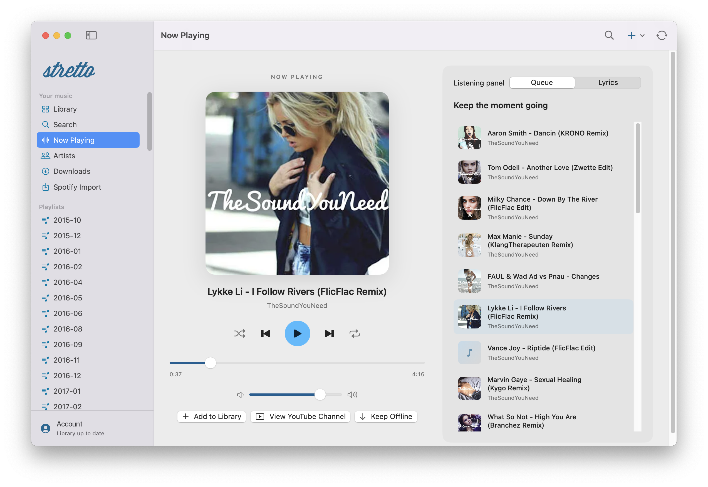

# Stretto Native for macOS

**Your Stretto library. A player that feels at home on your Mac.**

A native companion to [Stretto on the web](https://next.kaiserapps.com).
Bring your existing music library and playlists to a dedicated Mac app, discover
your next favorite track, and keep the music close without keeping a browser open.

## Made for your Mac

- **Native playback controls.** Play, pause, skip and seek with macOS media keys
  and Control Center.
- **A focused Now Playing view.** Artwork, playback controls, your queue and
  lyrics together in one place.
- **Music within reach.** Floating and menu-bar mini players keep controls handy
  while you work. Use Command-K for search and Command-Shift-M for the mini player.
- **Your preferred look.** Light, dark and system appearance, with Stretto's
  familiar blue.

## Your music, connected

- **Your existing Stretto account.** Sign in with email or Google and sync your
  library with the web app.
- **YouTube and SoundCloud.** Search, stream and preview music and YouTube
  playlists before adding them to your collection.
- **Explore YouTube channels.** Jump from a track to its uploader and browse
  videos by newest, oldest or most viewed.
- **Make it your library.** Create and edit playlists, update track details,
  follow artists and discover new releases.
- **Bring your Spotify playlists.** Import playlists by matching their tracks
  to YouTube, with unmatched tracks reported.
- **Listen offline.** Save favorite tracks with Keep Offline and reuse cached
  full listens.

Lyrics are available when a matching entry can be found. The native app currently
supports YouTube and SoundCloud playback; Spotify import is not Spotify audio
streaming. Audius playback and remote-device control are not included.

Requires **macOS 14 or newer**, on Apple Silicon or Intel.

For building from source, architecture and development details, see
[DESIGN.md](DESIGN.md).
